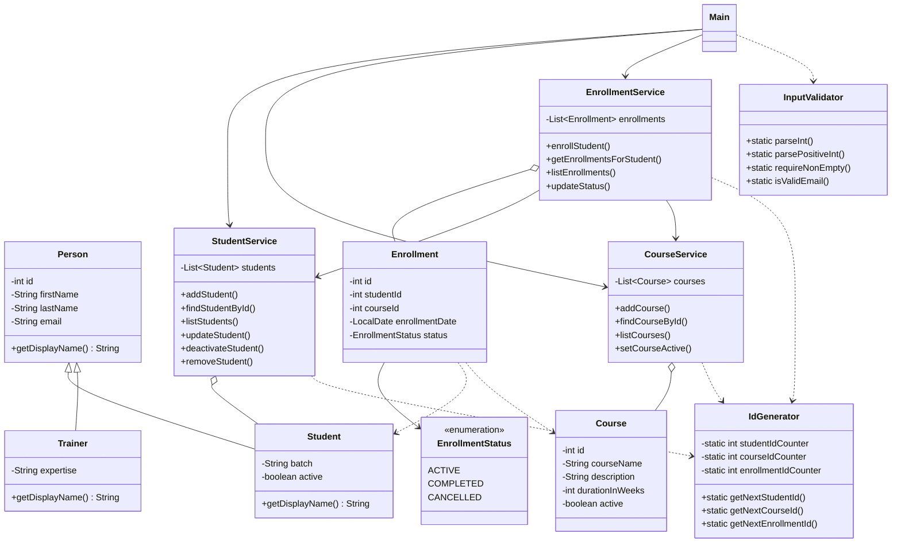

# LearnTrack

Console based Student and Course Management System in Core Java. Admin can manage students, courses and enrollments from a menu. Data is stored in memory using ArrayList (nothing is saved after the program closes).

## Features

Students
- add student (email is optional)
- view all students
- search student by id
- update email / batch
- deactivate student

Courses
- add course
- view all courses
- activate / deactivate course

Enrollments
- enroll student in a course
- view enrollments of a student
- view all enrollments
- mark enrollment as completed or cancelled

Option 4 in the main menu shows students and trainers together (used it to try out polymorphism).

Some sample students and courses are added when the program starts so it's easier to test.

## Folder structure

```
src/com/airtribe/learntrack/
    entity/      Person, Student, Trainer, Course, Enrollment, EnrollmentStatus
    service/     StudentService, CourseService, EnrollmentService
    ui/          Main
    exception/   EntityNotFoundException, InvalidInputException
    util/        IdGenerator, InputValidator
docs/
```

## How to run

Need JDK 17 or above. I used JDK 25.

Compile (Git Bash / Linux / Mac):
```
javac -d out $(find src -name "*.java")
```

Compile (PowerShell):
```
javac -d out (Get-ChildItem -Recurse -Filter *.java src).FullName
```

Run:
```
java -cp out com.airtribe.learntrack.ui.Main
```

Or open the folder in IntelliJ, mark `src` as sources root and run `Main`.

## Class Diagram



## Docs

- [Setup Instructions](docs/Setup_Instructions.md)
- [JVM Basics](docs/JVM_Basics.md)
- [Design Notes](docs/Design_Notes.md)
